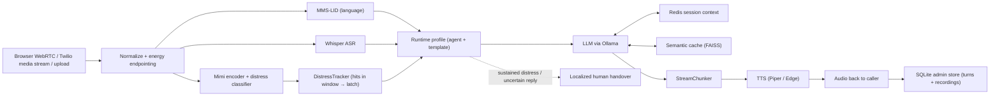

# Voice AI Model — Low-Cost Voice Agent for Indic Languages

[](https://github.com/jeevithg090/Voice-AI-Model/actions/workflows/ci.yml)

A self-hosted, real-time **speech-to-speech voice agent** for Indian languages
(Hindi, Tamil, Telugu, Kannada, English) built entirely from open models:
MMS-LID for language identification, Whisper for speech recognition, a local
LLM via Ollama, and Piper / Edge TTS for speech synthesis. A parallel
**acoustic distress detector** (Mimi codec embeddings + a trained classifier)
can force a human handover when a caller sounds distressed, even if their words
look neutral.

It accompanies the research draft in [`paper/`](paper/Solvathon_Layer1_Research_Draft.md)
(*A Low-Cost AI Voice Agent for Indic Languages with Integrated Voice Analysis*).

> **Safety note:** this system provides conversational assistance and decision
> support. It is **not** a certified medical or emergency-dispatch device.
> High-risk situations must be escalated to qualified humans and official
> emergency channels.

---

## Features

- **Three ways in:** browser WebRTC calls (`/offer`), a Twilio-compatible
  media-stream WebSocket (`/media-stream`), and single-turn uploads
  (`/voice-turn`, streaming SSE variant `/voice-turn-stream`) for networks where
  WebRTC is unreliable.
- **Automatic language detection** with `facebook/mms-lid-256`, restricted to
  Indian languages + English.
- **Speech recognition** with `openai/whisper-small` and energy-based endpointing.
- **LLM orchestration** through Ollama (`llama3.2:3b` by default) with
  - a **semantic cache** (FAISS inner-product index with exact-match fast path),
  - **Redis-backed conversation context** with background summarization,
  - **streamed, speech-friendly chunking** (punctuation / Indic danda / word
    count / time-based flush) so TTS can start before the LLM finishes.
- **TTS routing:** local Piper voices (including a custom Tamil voice,
  `ta_IN-iitm-female-s1-medium.onnx`) with Edge TTS fallback, and vice versa.
- **Safety-aware handover:** sustained acoustic distress, empty or uncertain
  LLM replies all trigger a localized human-handover message (`phone` or
  `kiosk` wording).
- **Admin panel** (`/admin`): editable prompt templates, multiple agents,
  one-click active-agent switching, full conversation transcripts and audio
  recordings (SQLite). Protected by HTTP Basic auth when `ADMIN_PASSWORD` is set.
- **Purpose agents** (`/agent-types`): hospital kiosk, college admission desk,
  laptop support — created on demand from templates.
- **Ops endpoints:** `/healthz`, `/ready` (model readiness), `/metrics`
  (counters + p50/p95 latencies per stage).
- **Graceful degradation:** the server boots and reports status even when
  models, Redis, Ollama or the distress classifier are unavailable.

## Tech stack

| Layer | Technology |
|---|---|
| Server | Python 3.10+, Flask, flask-sock, gunicorn + gevent |
| Realtime media | aiortc (WebRTC), PyAV, μ-law WebSocket media streams |
| Speech models | Hugging Face Transformers: Whisper, MMS-LID, Mimi (kyutai) |
| LLM | Ollama (`llama3.2:3b`, `llama3.2:1b` for summaries, `nomic-embed-text`) |
| Retrieval / state | FAISS, Redis, SQLite |
| TTS | Piper (local ONNX voices), Edge TTS |
| GPU | PyTorch on ROCm (AMD MI300X) — CUDA/MPS/CPU also detected |
| Deployment | Docker, docker compose, nginx, systemd |
| Quality | ruff (lint + format), pytest, GitHub Actions |

## Architecture



Per utterance:

1. Audio frames arrive (48 kHz) over WebRTC or as μ-law WebSocket frames.
2. Every 0.5 s window is scored by the distress detector (if loaded); hits are
   tracked per call by `DistressTracker`.
3. Every 1.5 s of audio is optionally re-classified by MMS-LID.
4. When silence follows speech, the utterance goes to Whisper.
5. The active agent/template is rendered into a system prompt; the LLM response
   is streamed, chunked, synthesized and played back chunk by chunk.
6. If distress is sustained, the LLM is skipped and a handover message is spoken.
7. User and assistant turns (text + audio) are persisted for the admin panel.

## Getting started

### Prerequisites

- Python **3.10+** (the Docker image uses 3.10)
- [Ollama](https://ollama.com) running locally (or reachable via `OLLAMA_BASE_URL`)
- Redis (optional — without it each turn is stateless)
- `ffmpeg` and `libsndfile`
- A GPU is strongly recommended. `requirements.txt` pins **ROCm 7.1** PyTorch
  wheels; on CUDA or CPU machines install PyTorch for your platform first
  (see the CI workflow for the CPU recipe).
- Outbound internet for the first model downloads (Hugging Face) and for Edge TTS.

### Install

```bash
git clone https://github.com/jeevithg090/Voice-AI-Model.git
cd Voice-AI-Model
python3 -m venv .venv && source .venv/bin/activate
pip install -r requirements.txt          # ROCm build
pip install -r requirements-dev.txt      # lint/test tooling (optional)
```

### Configure

```bash
cp .env.example .env    # then edit as needed
```

`.env` is loaded automatically. Key variables:

| Variable | Default | Purpose |
|---|---|---|
| `OLLAMA_BASE_URL` | `http://localhost:11434` | Ollama endpoint |
| `LLM_MODEL` / `SUMMARIZE_MODEL` / `EMBED_MODEL` | `llama3.2:3b` / `llama3.2:1b` / `nomic-embed-text` | Ollama models |
| `WHISPER_MODEL`, `LID_MODEL` | `openai/whisper-small`, `facebook/mms-lid-256` | Speech models |
| `TTS_BACKEND` | `auto` | `auto`, `piper` or `edge` |
| `REDIS_HOST`, `REDIS_PORT` | `localhost`, `6379` | Session context store |
| `ADMIN_USERNAME`, `ADMIN_PASSWORD` | `admin`, *(empty)* | Basic auth for `/admin*`; **set a password in any shared deployment** |
| `CORS_ORIGINS` | `*` | Comma-separated allowed origins |
| `MAX_UPLOAD_MB` | `20` | Upload limit for audio endpoints |
| `STUN_URLS`, `TURN_URLS`, `TURN_USERNAME`, `TURN_CREDENTIAL` | Google STUN, no TURN | WebRTC ICE servers |
| `ENABLE_EMERGENCY_DETECTION` | `true` | Load the distress detector if available |
| `EMERGENCY_CLASSIFIER_PATH` | `models/emergency_classifier.pt` | Classifier checkpoint |
| `EMERGENCY_THRESHOLD`, `DISTRESS_WINDOW`, `DISTRESS_MIN_HITS` | `0.7`, `5`, `3` | Sustained-distress rule |
| `HANDOVER_MODE` | `phone` | `phone` or `kiosk` handover wording |

See [`.env.example`](.env.example) for every option (endpointing thresholds,
Edge voices, streaming chunk sizes, cache paths, …).

### Models

```bash
# LLMs
ollama pull llama3.2:3b && ollama pull llama3.2:1b && ollama pull nomic-embed-text

# Piper voices (+ copies the bundled custom Tamil voice)
./src/tts/setup_piper.sh
```

Whisper, MMS-LID and Mimi download from Hugging Face on first start.

**Distress detector:** the server imports `MimiEmergencyClassifier` from
`src/models/emergency_classifier.py` and loads the checkpoint at
`EMERGENCY_CLASSIFIER_PATH`. Neither is currently included in this repository;
without them the server runs normally with distress detection disabled, and
`/ready` reports why.

### Run

```bash
python -m src.realtime.signaling_server          # dev server on SERVER_HOST:SERVER_PORT (0.0.0.0:8080)

# production-style (single gevent worker; models are per process)
gunicorn -k gevent -w 1 --worker-connections 1000 --timeout 0 \
  -b 0.0.0.0:8080 src.realtime.signaling_server:app
```

Open <http://localhost:8080/> (microphone access needs `localhost` or HTTPS).

| Page | Purpose |
|---|---|
| `/` or `/client` | Live call client (WebRTC or WebSocket) |
| `/call` | Alternative live call interface |
| `/push-to-talk` | Hold-to-talk upload client with agent-purpose selection (no WebRTC needed) |
| `/lid-test` | Language-ID tester |
| `/admin` | Templates, agents, conversations, recordings |

### Docker

```bash
cp .env.example .env
docker compose -f docker-compose.dev.yml up --build -d   # app + Ollama + Redis
docker compose up --build -d                             # adds nginx on :80/:443
curl http://localhost:8080/healthz
```

The compose files target AMD ROCm GPUs (`/dev/kfd`, `/dev/dri`). Redis and
Ollama are not published outside the compose network.

## Testing & quality

```bash
pip install -r requirements-dev.txt
ruff check . && ruff format --check .
pytest -m "not server"     # fast unit tests, no GPU/models needed
pytest -m server           # boots the real Flask app (needs the full stack; models may be offline)
```

The unit tests cover the language helpers, distress tracking, metrics,
ICE/auth helpers, stream chunking, similarity, semantic cache, admin store,
runtime-profile resolution, Redis context (via fakeredis), the Ollama client,
the embedding-agent flow and TTS routing. The server smoke tests run with
`HF_HUB_OFFLINE=1` and verify graceful degradation, UI routes, admin auth,
upload limits and path handling.

Live end-to-end checks against a running deployment are in
[`scripts/integration/`](scripts/integration), e.g.

```bash
python scripts/integration/check_pipeline.py --server http://localhost:8080
```

CI ([`.github/workflows/ci.yml`](.github/workflows/ci.yml)) runs lint, unit tests
on Python 3.10–3.12, and a CPU build of the full stack with the server smoke tests.

## API

### Realtime

| Method & path | Description |
|---|---|
| `POST /offer` | WebRTC SDP offer → answer (`{sdp, type, language?, auto_detect?, agent_id?}`) |
| `WS /media-stream` | Twilio-style media stream (`start` / `media` / `stop` events, μ-law 8 kHz) |
| `POST /voice-turn` | Multipart `audio` (+ `language`, `session_id`, `agent_id`, `agent_type`) → JSON with transcript, reply text, base64 WAV and per-stage timings |
| `POST /voice-turn-stream` | Same input, Server-Sent Events: `meta`, `transcript`, `llm_chunk`, `audio_chunk`, `done` (or `error`) |
| `POST /detect-lang` | Multipart `audio` → top Indian / global language candidates |
| `GET /agent-types` | Purpose agents available to clients |
| `GET /ice-config` | ICE servers for browser clients |
| `GET /ready` | 200 when Whisper + LID are loaded, else 503 (also reports distress-detector status) |
| `GET /healthz` | Liveness plus Redis/Ollama/model status |
| `GET /metrics` | Counters and latency stats (`stt_ms`, `llm_ttft_ms`, `tts_ms`, …) |

### Admin (Basic auth when `ADMIN_PASSWORD` is set)

`GET/POST /admin/templates`, `PUT /admin/templates/<id>`,
`GET/POST /admin/agents`, `GET/PUT /admin/agents/<id>`,
`POST /admin/agents/<id>/activate`, `GET /admin/active-agent`,
`GET /admin/conversations`, `GET /admin/conversations/<id>`,
`GET /admin/recordings/<path>`.

Templates use `{{placeholder}}` variables (e.g. `{{assistant_name}}`,
`{{detected_language}}`, `{{emergency_probability}}`) filled from template
defaults, agent config and live call metadata.

## Deployment

- [`DEPLOYMENT.md`](DEPLOYMENT.md) — DigitalOcean AMD MI300X droplet with Docker compose.
- [`SPLIT_DEPLOYMENT.md`](SPLIT_DEPLOYMENT.md) — local frontend + remote GPU backend.
- [`TELEPHONY_SETUP.md`](TELEPHONY_SETUP.md) — Twilio Media Streams.
- [`deploy/`](deploy) — nginx config, systemd unit, GPU host bootstrap script.

Production checklist: set `ADMIN_PASSWORD`, restrict `CORS_ORIGINS`, terminate
TLS at nginx, configure a TURN server for callers behind NAT, and keep Redis /
Ollama private.

## Reported performance (from the paper)

The figures below are **as reported in the authors' paper**, measured on an AMD
Instinct MI300X (ROCm 7.1) in February 2026 with small run counts. They have not
been re-measured as part of this repository's CI. Raw evidence is in
[`paper/evidence_remote/`](paper/evidence_remote) and [`results/`](results).

| Stage | Avg latency (ms) |
|---|---:|
| VAD (energy-based) | 0.92 |
| Speech preprocessing | 0.74 |
| LID (MMS-LID) | 21.18 |
| ASR (Whisper-small FP16) | 99.63 |
| Semantic cache lookup (FAISS) | 1.04 |
| Mimi speech encoder | 14.74 |
| Emergency classifier | 15.16 |
| LLM TTFT (`llama3.2:3b`) | 176.83 |
| LLM full response (25 tokens) | 368.90 |
| TTS first chunk | 188.25 |
| TTS full synthesis (English, Edge) | 251.04 |
| **Time to first sound (reported)** | **~488** |
| **End-to-end (reported)** | **~742** |

The paper estimates a direct operating cost of about **INR 0.95/min**
(telephony 0.50, GPU 0.35, infra 0.10) versus INR 7–15/min for commercial
offerings. Benchmark scripts: `scripts/component_latency_benchmark.py`,
`scripts/ollama_chunk_latency.py`, `scripts/benchmark_faiss_lookup.py`,
`src/benchmark_mimi_latency.py`, `src/benchmark_emergency_latency.py`.

## Project structure

```text
src/
  config.py              # All settings, from environment variables
  admin/                 # SQLite store (templates, agents, conversations) + prompt rendering
  llm/                   # Ollama client, semantic cache, Redis context, chunker, fillers
  realtime/
    signaling_server.py  # Flask app: WebRTC, WebSocket, upload endpoints, admin API, UIs
    language.py          # Language codes, handover/uncertainty logic, prompt rules
    distress.py          # Sustained-distress tracker
    emergency.py         # Optional Mimi + classifier loader
    metrics.py           # Counters and latency windows
    security.py          # ICE config and Basic-auth helpers
    audio_track.py, twilio_track.py, lid_only_server.py, *.html
  tts/                   # TTS manager (Piper / Edge) + Piper setup script
  utils/, datasets/, train/   # Dataset preparation, Mimi encoding, training scripts
scripts/                 # Benchmarks, paper-metric extraction
scripts/integration/     # Live checks against a running server / Ollama / Redis
tests/                   # pytest suite
deploy/                  # nginx, systemd, bootstrap
paper/, results/         # Research draft and measured evidence
Piper Tamil/             # Notes and scripts for training the custom Tamil Piper voice
*.ipynb                  # Colab notebooks (end-to-end demo, Indian language ID)
```

## Known limitations

- The emergency classifier module (`src/models/`) and training data helpers
  (`src/data/`) referenced by the training scripts are not in the repository,
  so the distress detector and its training pipeline cannot run from a fresh clone.
- The semantic cache is global: it is not partitioned by agent, language or
  caller, so cached replies can be reused across agents.
- Reported metrics come from small-sample runs on specific hardware.

## Citation

```bibtex
@article{gangadhar2026lowcostindicvoice,
  title={A Low-Cost AI Voice Agent for Indic Languages with Integrated Voice Analysis},
  author={Gangadhar, Jeevith and Naik, Nagaraj},
  year={2026},
  note={Preprint / project manuscript}
}
```

## License

Released under the MIT License — see [`LICENSE`](LICENSE).
