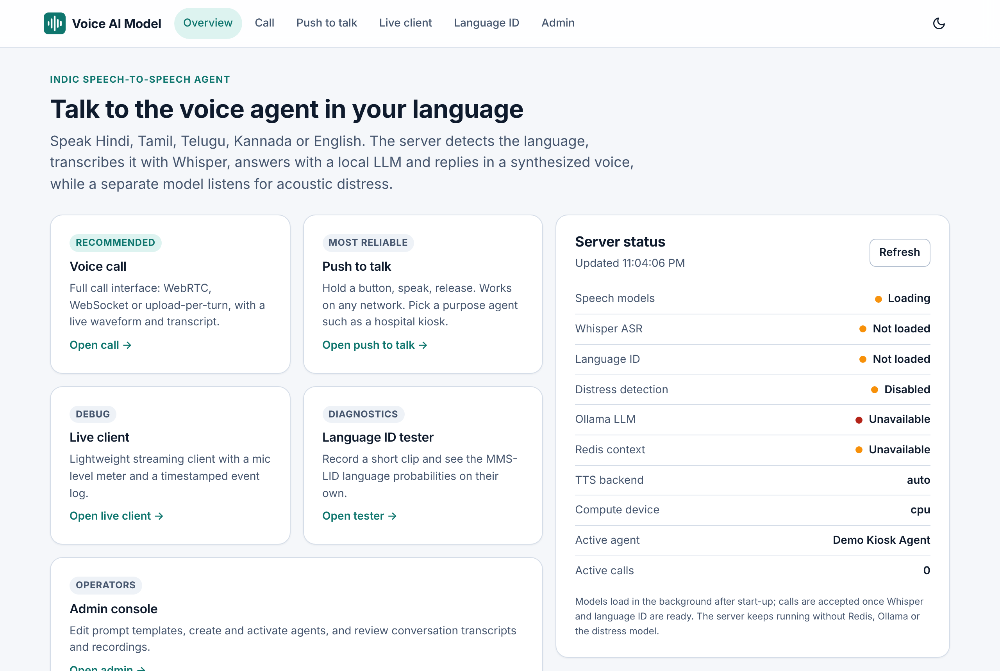
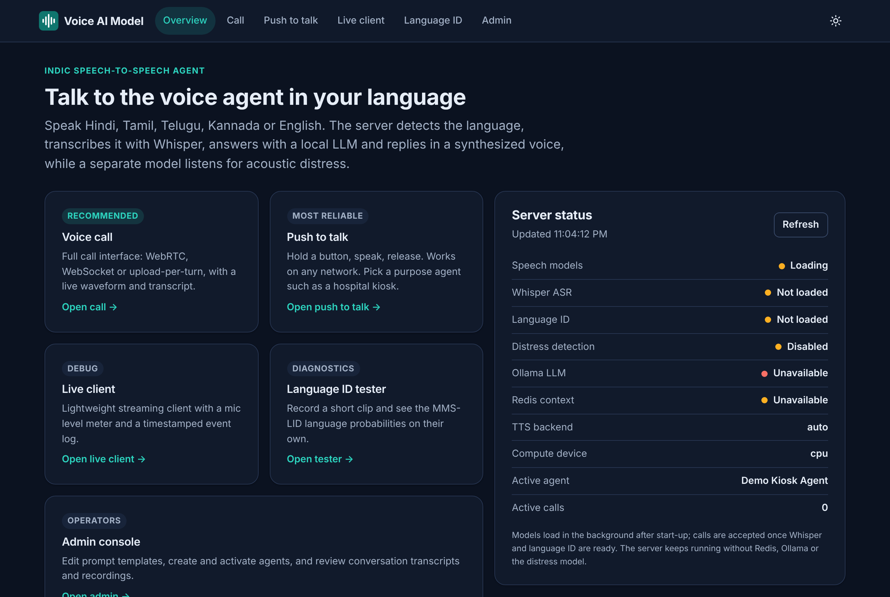
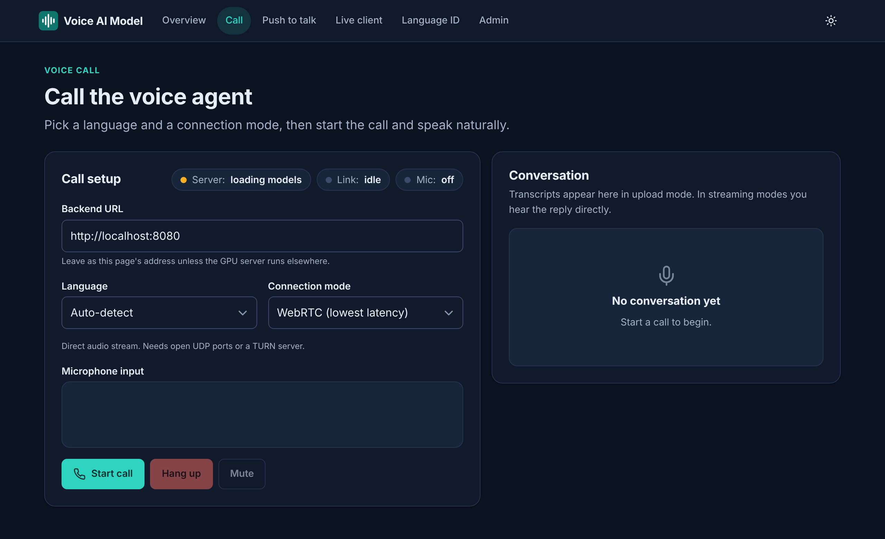
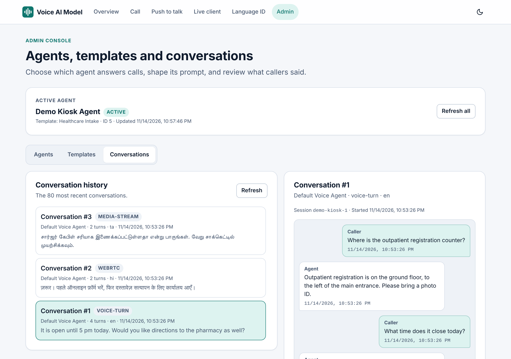
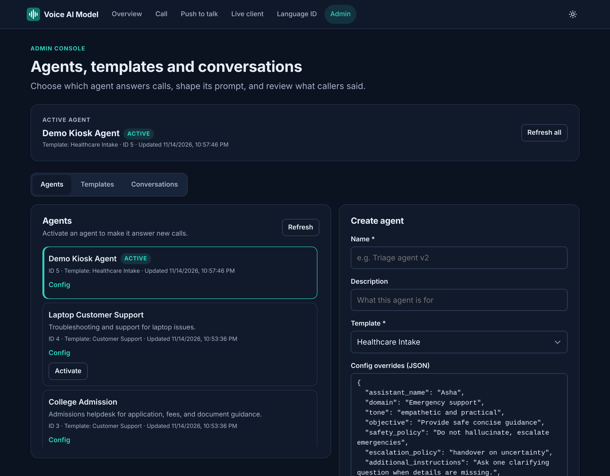
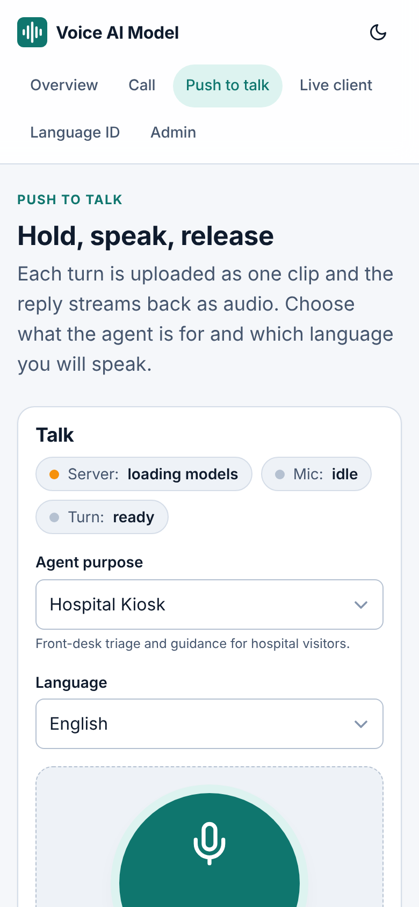
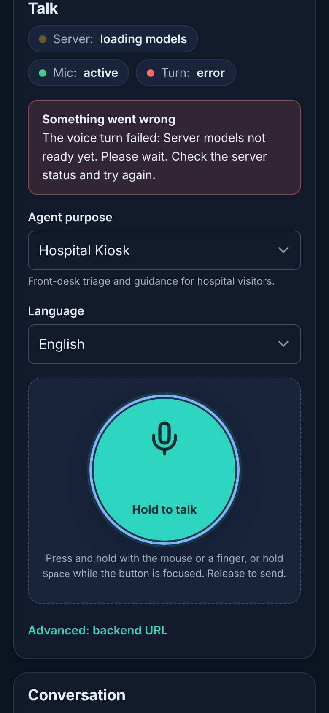
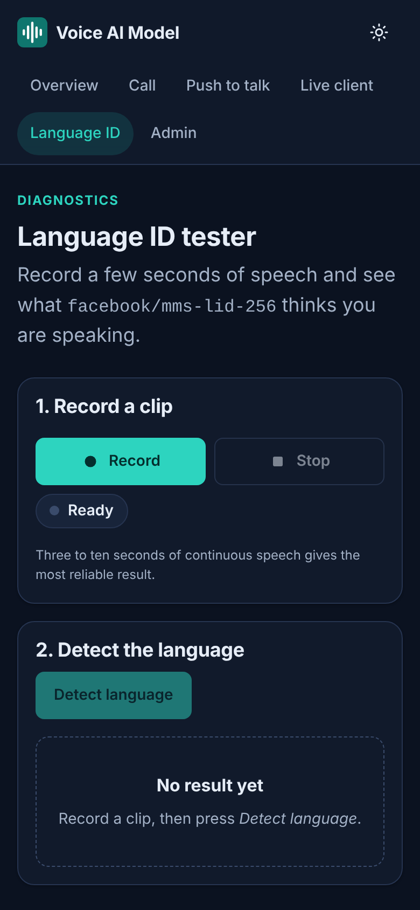
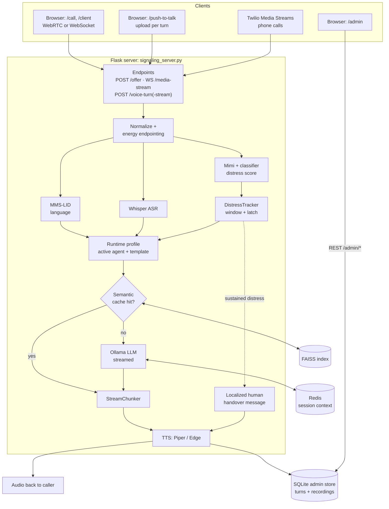

# Voice AI Model: a low-cost voice agent for Indic languages

[](https://github.com/jeevithg090/Voice-AI-Model/actions/workflows/ci.yml)


**Talk to an AI agent in Hindi, Tamil, Telugu, Kannada or English, in real time, on hardware you control, built only from open models.**



---

## Contents

- [Overview](#overview)
- [Screenshots](#screenshots)
- [Key features](#key-features)
- [Tech stack](#tech-stack)
- [Architecture](#architecture)
- [Project structure](#project-structure)
- [Getting started](#getting-started)
- [Configuration](#configuration)
- [Running the server](#running-the-server)
- [Using the web interface](#using-the-web-interface)
- [API reference](#api-reference)
- [API examples](#api-examples)
- [Scripts and commands](#scripts-and-commands)
- [Testing](#testing)
- [Linting and formatting](#linting-and-formatting)
- [Deployment](#deployment)
- [Reported performance](#reported-performance-from-the-paper)
- [Troubleshooting and FAQ](#troubleshooting-and-faq)
- [Known limitations](#known-limitations)
- [Roadmap ideas](#roadmap-ideas)
- [Contributing](#contributing)
- [Citation](#citation)
- [License](#license)

## Overview

Commercial voice agents for Indian languages are expensive per minute and send every call to a third-party cloud.
This project is a **self-hosted, real-time speech-to-speech voice agent**. It listens to a caller, works out which
language they speak, transcribes them, answers with a local large language model and speaks the answer back in the
same language.

The pipeline:

1. **Language ID** with Meta's MMS-LID (`facebook/mms-lid-256`), restricted to Indian languages and English.
2. **Speech recognition** with OpenAI Whisper (`openai/whisper-small`).
3. **Reasoning** with a local LLM served by [Ollama](https://ollama.com) (`llama3.2:3b` by default), plus a semantic
   cache and Redis-backed conversation memory.
4. **Speech synthesis** with local Piper voices (including a custom Tamil voice) or Microsoft Edge TTS.

In parallel, an optional **acoustic distress detector** (Kyutai Mimi codec embeddings and a trained classifier) listens
to *how* someone speaks, not what they say. When it detects sustained distress, the agent skips the LLM and hands the
caller over to a human.

**Who it is for:** researchers and engineers building Indic voice assistants, kiosks, helpdesks or call-centre
prototypes, who want a working end-to-end baseline they can run on their own GPU and study, measure and extend.
The repository accompanies the research draft in [`paper/`](paper/Solvathon_Layer1_Research_Draft.md),
*A Low-Cost AI Voice Agent for Indic Languages with Integrated Voice Analysis*.

> **Safety note:** this system gives conversational help and decision support. It is **not** a certified medical or
> emergency-dispatch device. High-risk situations must go to qualified humans and official emergency channels.

## Screenshots

All screenshots come from the running server, using the demo data from
[`scripts/seed_demo_data.py`](scripts/seed_demo_data.py). The speech models were not loaded when they were taken, so
status indicators show "loading" and the error state shown is the server's real reply when models aren't ready.

| | |
|---|---|
|  **Overview (dark mode).** Live health of every component, plus links to each tool. |  **Voice call.** WebRTC, WebSocket or upload-per-turn, with a live waveform and transcript. |
|  **Admin: conversations.** Transcripts shown as chat, with recordings when available. |  **Admin: agents.** Activate an agent, or create one from a template with validated JSON config. |

<p align="center">
  
  &nbsp;
  
  &nbsp;
  
</p>
<p align="center"><em>Phone layouts: push to talk, its inline error state, and the language ID tester.</em></p>

## Key features

**Voice pipeline**

- **Three ways to connect:** browser WebRTC calls (`POST /offer`), a Twilio-compatible μ-law media-stream WebSocket
  (`/media-stream`), and single-turn uploads (`POST /voice-turn`, or `POST /voice-turn-stream` for Server-Sent Events)
  for networks where WebRTC is unreliable.
- **Automatic language detection** with MMS-LID. Audio is re-classified periodically during a call, so the language
  can change mid-call.
- **Energy-based endpointing:** an utterance ends after `SILENCE_DURATION` seconds of silence that follow at least
  `MIN_SPEECH_DURATION` seconds of speech.
- **Streaming responses:** LLM tokens are cut into speech-friendly chunks (punctuation, the Indic danda `।`, word count
  or time-based flush), so TTS starts speaking before the LLM finishes.
- **Semantic cache:** a FAISS inner-product index over `nomic-embed-text` embeddings, with an exact-match fast path,
  answers repeated questions without calling the LLM.
- **Conversation memory:** a per-session Redis history with background summarization by a smaller model. Without
  Redis, each turn is stateless.
- **TTS routing:** local Piper voices first, with Edge TTS as the fallback, or the other way round (`TTS_BACKEND`).
  Includes the custom Tamil voice `ta_IN-iitm-female-s1-medium.onnx`.

**Safety**

- **Human handover:** sustained acoustic distress, or an empty or uncertain LLM reply, triggers a localized handover
  message, worded for a phone line or a kiosk (`HANDOVER_MODE`).
- **Per-call distress tracking:** `DistressTracker` counts detector hits in a sliding window and latches once
  `DISTRESS_MIN_HITS` of the last `DISTRESS_WINDOW` windows are above `EMERGENCY_THRESHOLD`.

**Operations**

- **Admin console** (`/admin`): prompt templates with `{{placeholders}}`, multiple agents, one-click activation, and
  every conversation's transcript and audio recordings (SQLite). Uses HTTP Basic auth when `ADMIN_PASSWORD` is set.
- **Purpose agents** (`GET /agent-types`): hospital kiosk, college admission desk and laptop support, created on demand
  from templates.
- **Health and metrics:** `/healthz` (liveness and component status), `/ready` (model readiness) and `/metrics`
  (counters plus p50/p95 per-stage latencies).
- **Graceful degradation:** the server starts and reports its status even when models, Redis, Ollama or the distress
  classifier are missing.

**Web interface**

- Six pages built on one small design system: overview, voice call, push to talk, live client, language ID tester and
  admin. There is also a 404 page.
- Light and dark themes (follows the OS, with a remembered toggle). Responsive from 320 px phones up to wide desktops.
- Accessible: semantic landmarks, a skip link, labelled controls, visible focus, keyboard-operable push to talk
  (hold <kbd>Space</kbd>) and admin tabs (arrow keys), and live regions for status changes. Every page passes axe-core
  WCAG 2 A/AA checks in both themes.
- Loading skeletons, empty states, inline errors with next steps, and field-level form validation.
- No build step, no framework and no external fonts. Plain HTML, CSS and JavaScript served by Flask.

## Tech stack

| Layer | Technology |
|---|---|
| Server | Python 3.10+, Flask, flask-sock, Flask-CORS, gunicorn + gevent |
| Realtime media | aiortc (WebRTC), PyAV, μ-law 8 kHz WebSocket media streams |
| Speech models | Hugging Face Transformers: Whisper, MMS-LID, Mimi (Kyutai) |
| LLM | Ollama: `llama3.2:3b` (answers), `llama3.2:1b` (summaries), `nomic-embed-text` (embeddings) |
| Retrieval and state | FAISS (`faiss-cpu`), Redis, SQLite |
| Text to speech | Piper (local ONNX voices), Edge TTS |
| Audio processing | librosa, soundfile, NumPy, torchaudio |
| GPU | PyTorch on ROCm 7.1 (AMD MI300X). CUDA, Apple MPS and CPU are detected automatically |
| Web UI | HTML, CSS custom properties and plain JavaScript, served from `src/realtime/` |
| Deployment | Docker, docker compose, nginx, systemd |
| Quality | pytest, fakeredis, ruff (lint and format), GitHub Actions |

## Architecture



**One utterance, step by step**

1. Audio arrives as 48 kHz WebRTC frames or 8 kHz μ-law WebSocket frames and is normalized.
2. Every 0.5 s window goes to the distress detector, if it is loaded. Hits are tracked per call.
3. Every 1.5 s of audio can be re-classified by MMS-LID (`ENABLE_LID_AUTODETECT`).
4. When silence follows speech, the utterance goes to Whisper.
5. The active agent's template is rendered into a system prompt with live call metadata (detected language, distress
   level, latency).
6. The semantic cache is checked. On a miss, the LLM response is streamed, chunked, synthesized and played back chunk
   by chunk.
7. If distress is sustained, or the reply is empty or uncertain, a handover message is spoken instead.
8. The user and assistant turns, with text and audio, are stored for the admin console.

## Project structure

```text
Voice-AI-Model/
├── src/
│   ├── config.py                 # Every setting, read from environment variables / .env
│   ├── admin/
│   │   ├── store.py              # SQLite store: templates, agents, conversations, recordings
│   │   └── runtime.py            # Resolves the active agent and renders {{placeholders}}
│   ├── llm/
│   │   ├── ollama_client.py      # Streaming Ollama chat + health check
│   │   ├── semantic_cache.py     # FAISS / cosine cache with exact-match fast path
│   │   ├── redis_context.py      # Per-session history + background summarization
│   │   ├── embedding_agent.py    # Cache-aware answer flow
│   │   ├── stream_chunker.py     # Splits streamed tokens into speakable chunks
│   │   ├── filler_manager.py     # Short "thinking" fillers per language
│   │   └── similarity.py
│   ├── realtime/
│   │   ├── signaling_server.py   # Flask app: WebRTC, WebSocket, uploads, admin API, UI routes
│   │   ├── language.py           # Language codes, handover/uncertainty rules
│   │   ├── distress.py           # Sustained-distress tracker
│   │   ├── emergency.py          # Optional Mimi + classifier loader
│   │   ├── metrics.py            # Counters and latency percentiles
│   │   ├── security.py           # ICE config + Basic-auth helpers
│   │   ├── audio_track.py        # aiortc output track
│   │   ├── twilio_track.py       # μ-law media-stream output
│   │   ├── lid_only_server.py    # Stand-alone language-ID server
│   │   ├── home.html             # /            overview + live status
│   │   ├── call_interface.html   # /call        full call UI
│   │   ├── push_to_talk.html     # /push-to-talk
│   │   ├── client.html           # /client      streaming client + event log
│   │   ├── lid_test.html         # /lid-test
│   │   ├── admin_panel.html      # /admin
│   │   ├── 404.html              # not-found page
│   │   └── static/               # ui.css (design system), ui.js (shared helpers), favicon.svg
│   ├── tts/                      # TTS manager (Piper / Edge) + setup_piper.sh
│   ├── train/, train_emergency_classifier.py, datasets/, utils/
│   │                             # Dataset preparation, Mimi encoding, classifier training
│   └── benchmark_*.py, test_*.py # Latency benchmarks and manual model checks
├── scripts/
│   ├── seed_demo_data.py         # Demo conversations for the admin console
│   ├── *benchmark*.py, ollama_chunk_latency.py, extract_paper_metrics.py
│   └── integration/              # Live checks against a running server / Ollama / Redis
├── tests/                        # pytest suite (unit + server smoke tests)
├── deploy/                       # nginx.conf, systemd unit, GPU bootstrap script
├── docs/screenshots/             # Images used in this README
├── paper/, results/              # Research draft and measured evidence
├── Piper Tamil/                  # Notes and scripts for training the Tamil Piper voice
├── gpu_wav_samples/              # Sample /voice-turn responses captured on the GPU host
├── *.ipynb                       # Colab notebooks (end-to-end demo, Indian language ID)
├── ta_IN-iitm-female-s1-medium.onnx(.json)  # Custom Tamil Piper voice
├── Dockerfile, docker-compose.yml, docker-compose.dev.yml
├── requirements.txt, requirements-dev.txt, pyproject.toml
└── .env.example                  # Every configuration variable, documented
```

## Getting started

### Prerequisites

| Requirement | Notes |
|---|---|
| Python **3.10 or newer** | The Docker image uses 3.10. CI tests 3.10 to 3.12. |
| `ffmpeg` and `libsndfile` | `sudo apt-get install ffmpeg libsndfile1` (Debian/Ubuntu) or `brew install ffmpeg libsndfile` |
| [Ollama](https://ollama.com) | Running locally or reachable through `OLLAMA_BASE_URL` |
| Redis | Optional. Without it, conversation memory is off. |
| A GPU | Strongly recommended. `requirements.txt` pins **ROCm 7.1** PyTorch wheels. CUDA, MPS and CPU also work (see below). |
| Internet on first start | Hugging Face model downloads (Whisper, MMS-LID, Mimi) and Edge TTS |
| A modern browser | Chrome, Edge, Firefox or Safari. Microphone access needs `https://` or `localhost`. |

### 1. Clone and create a virtual environment

```bash
git clone https://github.com/jeevithg090/Voice-AI-Model.git
cd Voice-AI-Model
python3 -m venv .venv
source .venv/bin/activate          # Windows: .venv\Scripts\activate
```

### 2. Install PyTorch for your hardware, then the rest

**AMD GPU (ROCm 7.1), as pinned:**

```bash
pip install -r requirements.txt
```

**NVIDIA GPU, Apple Silicon or CPU:** install PyTorch for your platform first (see
[pytorch.org](https://pytorch.org/get-started/locally/)), then install everything except the pinned ROCm wheels:

```bash
pip install torch torchaudio                                   # pick the right command from pytorch.org
grep -vE '^(--extra-index-url|torch|torchaudio)' requirements.txt > /tmp/requirements-no-torch.txt
pip install -r /tmp/requirements-no-torch.txt
```

**Optional development tools** (pytest, ruff, fakeredis):

```bash
pip install -r requirements-dev.txt
```

### 3. Configure

```bash
cp .env.example .env     # every variable is optional; edit what you need
```

`.env` is loaded automatically at start-up. See [Configuration](#configuration) for every variable.

### 4. Pull the LLMs and voices

```bash
ollama pull llama3.2:3b
ollama pull llama3.2:1b
ollama pull nomic-embed-text

./src/tts/setup_piper.sh     # downloads Piper + voices and copies the bundled Tamil voice
```

Whisper, MMS-LID and Mimi download from Hugging Face the first time the server starts.

### 5. (Optional) Distress detector

The server imports `MimiEmergencyClassifier` from `src/models/emergency_classifier.py` and loads the checkpoint at
`EMERGENCY_CLASSIFIER_PATH` (default `models/emergency_classifier.pt`). **Neither is in this repository yet.** Without
them the server runs normally with distress detection turned off, and `/ready`, `/healthz` and the overview page show
why.

### 6. Start the server

```bash
python -m src.realtime.signaling_server
```

Open <http://localhost:8080/>. The overview page shows each component's status. Calls are accepted once Whisper and
language ID have finished loading.

## Configuration

All settings come from environment variables (or `.env`). Every variable is optional; the defaults below come from
[`src/config.py`](src/config.py) and [`.env.example`](.env.example).

### Server and security

| Variable | Required | Default | Description |
|---|---|---|---|
| `SERVER_HOST` | No | `0.0.0.0` | Bind address for `python -m src.realtime.signaling_server` |
| `SERVER_PORT` | No | `8080` | Port for the dev server |
| `CORS_ORIGINS` | No | `*` | Comma-separated allowed origins, or `*` for any |
| `MAX_UPLOAD_MB` | No | `20` | Max upload size for `/voice-turn`, `/voice-turn-stream` and `/detect-lang` |
| `ADMIN_USERNAME` | No | `admin` | Basic-auth user for `/admin*` |
| `ADMIN_PASSWORD` | Yes, for any shared deployment | *(empty: auth off)* | Basic-auth password for `/admin*` (UI, API and recordings) |
| `ADMIN_DB_PATH` | No | `data/admin/voice_agent.db` | SQLite file for templates, agents and conversations |
| `CONVERSATION_MEDIA_DIR` | No | `data/conversation_media` | Where turn recordings are stored |

### WebRTC

| Variable | Required | Default | Description |
|---|---|---|---|
| `STUN_URLS` | No | `stun:stun.l.google.com:19302,stun:stun1.l.google.com:19302` | Comma-separated STUN servers |
| `TURN_URLS` | Recommended behind NAT | *(empty)* | Comma-separated TURN servers, e.g. `turn:turn.example.com:3478` |
| `TURN_USERNAME` | With `TURN_URLS` | *(empty)* | TURN username |
| `TURN_CREDENTIAL` | With `TURN_URLS` | *(empty)* | TURN password |

### LLM and cache

| Variable | Required | Default | Description |
|---|---|---|---|
| `OLLAMA_BASE_URL` | No | `http://localhost:11434` | Ollama endpoint (compose overrides it to `http://ollama:11434`) |
| `LLM_MODEL` | No | `llama3.2:3b` | Model that answers callers |
| `SUMMARIZE_MODEL` | No | `llama3.2:1b` | Model for background context summaries |
| `EMBED_MODEL` | No | `nomic-embed-text` | Embedding model for the semantic cache |
| `SEMANTIC_CACHE_PATH` | No | `semantic_cache.json` | Where the semantic cache is persisted |
| `VOICE_TURN_MAX_TOKENS` | No | `80` | Token cap for upload-mode replies |

### Speech models

| Variable | Required | Default | Description |
|---|---|---|---|
| `WHISPER_MODEL` | No | `openai/whisper-small` | Hugging Face ASR model |
| `LID_MODEL` | No | `facebook/mms-lid-256` | Hugging Face language-ID model |
| `HF_CACHE_DIR` | No | `/mnt/scratch/hf` in `.env.example` | Host path mounted as the Hugging Face cache in compose |
| `TORCH_CACHE_DIR` | No | `/mnt/scratch/torch` in `.env.example` | Host path mounted as the Torch cache in compose |

### Text to speech

| Variable | Required | Default | Description |
|---|---|---|---|
| `TTS_BACKEND` | No | `auto` | `auto` (Piper, then Edge), `piper` or `edge` |
| `PIPER_MODELS_DIR` | No | `src/tts/piper_models` | Directory of Piper `.onnx` voices |
| `PIPER_PATH` | No | *(empty: auto-detect)* | Path to the `piper` binary |
| `EDGE_TTS_VOICE_EN` / `_HI` / `_TA` / `_TE` / `_KN` | No | `en-US-AriaNeural` / `hi-IN-SwaraNeural` / `ta-IN-PallaviNeural` / `te-IN-MohanNeural` / `kn-IN-SapnaNeural` | Edge voice per language |
| `EDGE_TTS_RATE` | No | `+0%` | Speaking-rate adjustment |
| `EDGE_TTS_VOLUME` | No | `+0%` | Volume adjustment |
| `EDGE_TTS_PITCH` | No | `+0Hz` | Pitch adjustment |

### Audio, behaviour and streaming

| Variable | Required | Default | Description |
|---|---|---|---|
| `SILENCE_THRESHOLD` | No | `0.01` | RMS level below which audio counts as silence |
| `SILENCE_DURATION` | No | `2.0` | Seconds of silence that end an utterance |
| `MIN_SPEECH_DURATION` | No | `1.0` | Minimum seconds of speech before an utterance is processed |
| `ENABLE_TWILIO` | No | `true` | Enable the `/media-stream` WebSocket |
| `ENABLE_LID_AUTODETECT` | No | `true` | Re-run language ID during calls |
| `HANDOVER_MODE` | No | `phone` | `phone` or `kiosk` wording for handover messages |
| `METRICS_WINDOW` | No | `200` | Samples kept per latency metric |
| `STREAM_CHUNK_MIN_WORDS` | No | `4` | Minimum words before a chunk is spoken |
| `STREAM_CHUNK_MAX_QUEUE` | No | `8` | Max queued TTS chunks |
| `STREAM_CHUNK_FLUSH_MS` | No | `800` | Force-flush a chunk after this many ms |
| `VOICE_TURN_STREAM_ENABLED` | No | `true` | Advertise and serve `/voice-turn-stream` (SSE) |

### Redis

| Variable | Required | Default | Description |
|---|---|---|---|
| `REDIS_HOST` | No | `localhost` | Redis host (compose sets `redis`) |
| `REDIS_PORT` | No | `6379` | Redis port |
| `REDIS_DB` | No | `0` | Redis database index |
| `REDIS_SESSION_TTL` | No | `1800` | Seconds before an idle session's context expires |

### Distress detection

| Variable | Required | Default | Description |
|---|---|---|---|
| `ENABLE_EMERGENCY_DETECTION` | No | `true` | Try to load the distress detector |
| `MIMI_MODEL` | No | `kyutai/mimi` | Mimi codec used for embeddings |
| `EMERGENCY_CLASSIFIER_PATH` | No | `models/emergency_classifier.pt` | Classifier checkpoint |
| `EMERGENCY_THRESHOLD` | No | `0.7` | Probability above which a window counts as a hit |
| `DISTRESS_WINDOW` | No | `5` | Number of recent windows considered |
| `DISTRESS_MIN_HITS` | No | `3` | Hits within the window that trigger handover |

## Running the server

### Development

```bash
source .venv/bin/activate
python -m src.realtime.signaling_server         # Flask dev server on SERVER_HOST:SERVER_PORT
```

### Production (single host, no Docker)

```bash
gunicorn -k gevent -w 1 --worker-connections 1000 --timeout 0 \
  -b 0.0.0.0:8080 src.realtime.signaling_server:app
```

Keep **one worker**: models and asyncio state live in the process, so more workers would load the models more than
once and split call state. For a boot-time service, [`deploy/solvathon.service`](deploy/solvathon.service) is a
systemd unit that starts the Docker compose stack.

### Docker

```bash
cp .env.example .env
docker compose -f docker-compose.dev.yml up --build -d    # app + Ollama + Redis
docker compose up --build -d                              # also nginx on :80 / :443
docker compose logs -f app
curl http://localhost:8080/healthz
```

The compose files target AMD ROCm GPUs (`/dev/kfd`, `/dev/dri`). Redis and Ollama are internal to the compose network
and not published. Pull the LLMs into the Ollama container once:

```bash
docker compose exec ollama ollama pull llama3.2:3b
docker compose exec ollama ollama pull llama3.2:1b
docker compose exec ollama ollama pull nomic-embed-text
```

## Using the web interface

| Page | Path | What it is for |
|---|---|---|
| Overview | `/` | Live status of models, Ollama, Redis, TTS, the active agent and call count, with links to every tool |
| Voice call | `/call` | The main call UI: WebRTC, WebSocket or upload-per-turn, with a waveform and transcript |
| Push to talk | `/push-to-talk` | Hold to record, release to send. Works on any network. Choose a purpose agent. |
| Live client | `/client` | Minimal streaming client with a mic level meter and a timestamped event log, for debugging |
| Language ID | `/lid-test` | Record a clip and see MMS-LID's top Indian and global language probabilities |
| Admin | `/admin` | Agents, templates and conversation history (Basic auth when `ADMIN_PASSWORD` is set) |

**Make your first call**

1. Start the server and open <http://localhost:8080/>. Wait until **Speech models** shows **Ready**.
2. Open **Push to talk**, choose an agent purpose (for example *Hospital Kiosk*) and a language.
3. Hold the round button (or focus it and hold <kbd>Space</kbd>), ask a question, then release.
4. Your transcript and the agent's reply appear in the conversation panel with timings, and the reply plays back.
   If the browser blocks autoplay, a **Play reply** button appears.
5. For a hands-free call, open **Voice call**, pick **WebSocket** (or **WebRTC** on an open network) and press
   **Start call**.

**Shape the agent**

1. Open **Admin → Templates** and create a template. Its system prompt can use placeholders such as
   `{{assistant_name}}`, `{{domain}}`, `{{tone}}`, `{{detected_language}}` and `{{emergency_probability}}`.
2. In **Admin → Agents**, create an agent from that template. Its JSON config fills or overrides the template's
   defaults (for example `temperature`, `max_tokens`, `similarity_threshold`).
3. Press **Activate**. New calls use that agent. Review results under **Admin → Conversations**.

**Try the admin console without making calls**

```bash
python scripts/seed_demo_data.py      # adds three clearly labelled demo conversations (en, hi, ta)
```

**Pointing the UI at another server:** every client page accepts a backend URL (in the form, or as
`?backend=https://gpu.example.com` in the address) and remembers it in the browser. This is how the
[split deployment](SPLIT_DEPLOYMENT.md) works. Remember to allow that origin in `CORS_ORIGINS`.

## API reference

### Realtime and voice

| Method | Path | Auth | Description |
|---|---|---|---|
| `POST` | `/offer` | None | WebRTC SDP offer in, answer out. Body: `{sdp, type, language?, auto_detect?, agent_id?}`. Returns 503 while models load. |
| `WS` | `/media-stream` | None | Twilio-style media stream: `start` / `media` / `stop` JSON events, μ-law 8 kHz audio |
| `POST` | `/voice-turn` | None | Multipart `audio` plus optional `language`, `auto_detect`, `session_id`, `agent_id`, `agent_type`. Returns the transcript, reply, base64 WAV and per-stage timings. |
| `POST` | `/voice-turn-stream` | None | Same input. Returns Server-Sent Events: `meta`, `transcript`, `llm_chunk`, `audio_chunk`, `done` (or `error`). |
| `POST` | `/detect-lang` | None | Multipart `audio`. Returns the top Indian and global language candidates. |
| `GET` | `/agent-types` | None | Purpose agents (`hospital_kiosk`, `college_admission`, `laptop_support`) and their agent IDs |
| `GET` | `/ice-config` | None | ICE servers for browser clients (from `STUN_URLS` / `TURN_*`) |

### Health

| Method | Path | Auth | Description |
|---|---|---|---|
| `GET` | `/healthz` | None | Liveness: device, model, Redis and Ollama status, distress detector, active agent, active calls. Always 200 while the process is up. |
| `GET` | `/ready` | None | 200 when Whisper and MMS-LID are loaded, otherwise 503. Also reports distress-detector status. |
| `GET` | `/metrics` | None | Counters and latency stats (`stt_ms`, `llm_ttft_ms`, `tts_ms`, ...) |

### Admin

All `/admin*` routes require HTTP Basic auth when `ADMIN_PASSWORD` is set.

| Method | Path | Auth | Description |
|---|---|---|---|
| `GET` | `/admin` | Basic | Admin console (HTML) |
| `GET` | `/admin/templates` | Basic | List templates |
| `POST` | `/admin/templates` | Basic | Create a template: `{name, system_prompt, description?, defaults?}`. Returns 201, or 400 on validation errors. |
| `PUT` | `/admin/templates/<id>` | Basic | Update a template |
| `GET` | `/admin/agents` | Basic | List agents |
| `POST` | `/admin/agents` | Basic | Create an agent: `{name, template_id, description?, config?}`. Returns 201. |
| `GET` | `/admin/agents/<id>` | Basic | Get one agent (404 if missing) |
| `PUT` | `/admin/agents/<id>` | Basic | Update an agent |
| `POST` | `/admin/agents/<id>/activate` | Basic | Make this agent answer new calls |
| `GET` | `/admin/active-agent` | Basic | The currently active agent |
| `GET` | `/admin/conversations?limit=&offset=` | Basic | Recent conversations (default limit 50) |
| `GET` | `/admin/conversations/<id>` | Basic | One conversation with its turns and recording URLs |
| `GET` | `/admin/recordings/<path>` | Basic | A stored recording (path traversal is rejected) |

### Pages and static files

| Method | Path | Auth | Description |
|---|---|---|---|
| `GET` | `/`, `/call`, `/push-to-talk`, `/client`, `/lid-test` | None | Web UI pages |
| `GET` | `/static/<file>` | None | `ui.css`, `ui.js`, `favicon.svg` |
| `GET` | `/favicon.ico` | None | SVG favicon |
| any | unknown path | None | 404: an HTML page for browsers, `{"error": "Not found"}` for API clients |

## API examples

**Health check** (real output from a server with models still loading and no Redis or Ollama running):

```bash
curl -s http://localhost:8080/healthz
```

```json
{
  "active_agent": "Default Voice Agent",
  "active_calls": 0,
  "device": "cpu",
  "emergency_detection": "classifier module unavailable (No module named 'src.models')",
  "lid_ready": false,
  "ollama": {"available_models": [], "embed_model_ready": false, "llm_model_ready": false, "server_running": false},
  "redis": false,
  "status": "ok",
  "tts_backend": "auto",
  "voice_turn_stream_enabled": true,
  "whisper_ready": false
}
```

**Readiness** returns HTTP 503 until the speech models are loaded:

```bash
curl -s -o /dev/null -w "%{http_code}\n" http://localhost:8080/ready    # 503, then 200
```

**One voice turn** by upload:

```bash
curl -s -X POST http://localhost:8080/voice-turn \
  -F audio=@question.wav \
  -F language=hi \
  -F agent_type=hospital_kiosk \
  -F session_id=demo-1
```

```jsonc
{
  "ok": true,
  "session_id": "demo-1",
  "conversation_id": 12,
  "agent_id": 2,
  "agent_name": "Hospital Kiosk",
  "agent_type": "hospital_kiosk",
  "language": "hi",
  "transcript": "...",              // what Whisper heard
  "response": "...",                // the agent's reply text
  "audio_b64": "UklGRuRAIwBXQVZF...", // base64 WAV of the spoken reply
  "audio_mime": "audio/wav",
  "timings_ms": {"stt_ms": 0, "llm_ttft_ms": 0, "llm_total_ms": 0, "tts_first_chunk_ms": 0, "tts_total_ms": 0, "turn_total_ms": 0}
}
```

The response has these keys; the values above are placeholders. Real responses captured on the GPU host are in
[`gpu_wav_samples/`](gpu_wav_samples). While models are loading, the endpoint returns
`503 {"error": "Server models not ready yet. Please wait."}`.

**Streaming voice turn** (Server-Sent Events):

```bash
curl -N -X POST http://localhost:8080/voice-turn-stream \
  -H "Accept: text/event-stream" -F audio=@question.wav -F language=auto
```

```text
event: meta
data: {"session_id": "...", "language": "...", "agent_id": 2, "agent_name": "..."}

event: transcript
data: {"text": "..."}

event: llm_chunk
data: {"index": 1, "text": "..."}

event: audio_chunk
data: {"index": 1, "audio_b64": "...", "audio_mime": "audio/wav"}

event: done
data: {"response": "...", "timings_ms": {...}, "chunk_count": 3}
```

**Language detection:**

```bash
curl -s -X POST http://localhost:8080/detect-lang -F audio=@clip.webm
# {"status": "success", "top_indian": [{"code": "hin", "name": "Hindi", "prob": ...}, ...],
#  "top_global": [...], "energy": ..., "duration": ...}
```

**Purpose agents** (real output):

```bash
curl -s http://localhost:8080/agent-types
```

```json
{"agent_types": [
  {"agent_id": 2, "type": "hospital_kiosk", "label": "Hospital Kiosk", "description": "Front-desk triage and guidance for hospital visitors."},
  {"agent_id": 3, "type": "college_admission", "label": "College Admission", "description": "Admissions helpdesk for application, fees, and document guidance."},
  {"agent_id": 4, "type": "laptop_support", "label": "Laptop Customer Support", "description": "Troubleshooting and support for laptop issues."}
]}
```

**Admin API with auth:**

```bash
curl -s -u admin:$ADMIN_PASSWORD http://localhost:8080/admin/agents
curl -s -u admin:$ADMIN_PASSWORD -X POST http://localhost:8080/admin/agents \
  -H "Content-Type: application/json" \
  -d '{"name": "Clinic desk", "template_id": 1, "config": {"assistant_name": "Asha", "tone": "calm"}}'
curl -s -u admin:$ADMIN_PASSWORD -X POST http://localhost:8080/admin/agents/5/activate
```

## Scripts and commands

| Command | What it does |
|---|---|
| `python -m src.realtime.signaling_server` | Run the dev server |
| `gunicorn -k gevent -w 1 --timeout 0 -b 0.0.0.0:8080 src.realtime.signaling_server:app` | Run the production server |
| `python -m src.realtime.lid_only_server` | Stand-alone language-ID server |
| `./src/tts/setup_piper.sh` | Install Piper and voices, including the bundled Tamil voice |
| `python scripts/seed_demo_data.py [--db PATH]` | Add demo conversations to the admin database |
| `pytest` | Full test suite |
| `pytest -m "not server"` | Fast unit tests (no torch or models needed) |
| `pytest -m server` | Server smoke tests (full stack installed, models may be offline) |
| `ruff check .` / `ruff format .` | Lint / format |
| `python scripts/integration/check_pipeline.py --server http://localhost:8080` | Live end-to-end check against a running server |
| `python scripts/integration/check_raw_ollama.py` and other `check_*.py` | Live checks for Ollama, streaming TTS, prompts and multilingual output |
| `python scripts/component_latency_benchmark.py` | Per-component latency benchmark |
| `python scripts/ollama_chunk_latency.py` | LLM time-to-first-chunk benchmark |
| `python scripts/benchmark_faiss_lookup.py` | Semantic-cache lookup benchmark |
| `python src/benchmark_mimi_latency.py`, `python src/benchmark_emergency_latency.py` | Distress-detector latency benchmarks |
| `python scripts/extract_paper_metrics.py [--pipeline-url URL]` | Re-measure the paper's metrics against live Ollama and the pipeline, writing evidence files |
| `docker compose -f docker-compose.dev.yml up --build -d` | App + Ollama + Redis in Docker |
| `docker compose up --build -d` | Same, plus nginx |

## Testing

```bash
pip install -r requirements-dev.txt
pytest -m "not server"                                       # unit tests, about 90, no GPU or models needed
HF_HUB_OFFLINE=1 TRANSFORMERS_OFFLINE=1 pytest -m server     # server smoke tests, needs the full stack
pytest                                                       # everything (114 tests)
```

**What is covered**

- **Unit tests:** language helpers and handover rules, the distress tracker, metrics, ICE and Basic-auth helpers, the
  stream chunker, similarity, the semantic cache (FAISS and cosine), the admin store, runtime-profile rendering, Redis
  context (with fakeredis), the Ollama client, the embedding agent, TTS routing and fallback, and fillers.
- **Server smoke tests** boot the real Flask app with no models and check graceful degradation (`/healthz` 200,
  `/ready` 503), 503s from model-guarded endpoints, every UI page (shared stylesheet, script, favicon, description,
  main landmark), static assets, HTML/JSON 404s, admin auth and CRUD, upload limits and recording path traversal.

**Not covered automatically:** real model inference, real WebRTC media, Twilio calls and the browser UI's JavaScript.
The UI was checked by hand with Playwright at 375, 768 and 1280 px in both themes, and with axe-core. Live checks for
a running deployment are in [`scripts/integration/`](scripts/integration).

CI ([`.github/workflows/ci.yml`](.github/workflows/ci.yml)) runs lint, unit tests on Python 3.10 to 3.12, and a CPU
build of the full stack with the server smoke tests.

## Linting and formatting

[ruff](https://docs.astral.sh/ruff/) handles both, configured in [`pyproject.toml`](pyproject.toml) (line length 120,
rule sets E, F, W, I, B, UP, SIM, C4).

```bash
ruff check .            # lint
ruff check . --fix      # lint and auto-fix
ruff format .           # format
ruff format --check .   # what CI runs
```

Notebooks, `paper/`, `results/`, `Piper Tamil/` and `gpu_wav_samples/` are excluded. The HTML, CSS and JavaScript are
not linted by a tool; follow the existing style (2-space indent, design tokens from `static/ui.css`).

## Deployment

| Guide | Scenario |
|---|---|
| [`DEPLOYMENT.md`](DEPLOYMENT.md) | DigitalOcean AMD MI300X droplet with Docker compose |
| [`SPLIT_DEPLOYMENT.md`](SPLIT_DEPLOYMENT.md) | Browser on your machine, GPU backend in the cloud |
| [`TELEPHONY_SETUP.md`](TELEPHONY_SETUP.md) | Real phone numbers through Twilio Media Streams |
| [`deploy/`](deploy) | `nginx.conf`, systemd unit `solvathon.service` (starts the compose stack), `do_gpu_bootstrap.sh` |

**Typical Docker deployment on a GPU host**

1. Install Docker and the ROCm drivers (or adapt the compose `devices` for NVIDIA).
2. `git clone` the repository, then `cp .env.example .env` and set at least `ADMIN_PASSWORD` and `CORS_ORIGINS`.
3. `docker compose up --build -d`, then pull the Ollama models (see [Docker](#docker)).
4. Watch `docker compose logs -f app` until the models load, then check `curl http://localhost:8080/ready`.
5. Point a domain at the host, get a certificate, and enable the TLS block in `deploy/nginx.conf`. Browsers need HTTPS
   for microphone access on anything other than `localhost`.

**Production checklist**

- [ ] `ADMIN_PASSWORD` set, so `/admin` and recordings are protected
- [ ] `CORS_ORIGINS` limited to your front-end origins
- [ ] TLS terminated at nginx
- [ ] A TURN server configured (`TURN_URLS`, `TURN_USERNAME`, `TURN_CREDENTIAL`) if callers sit behind NAT
- [ ] Redis and Ollama kept private (the compose files already do this)
- [ ] One gunicorn worker per GPU process
- [ ] `data/` (admin database and recordings) on persistent storage and backed up

## Reported performance (from the paper)

These figures are **as reported in the authors' paper**, measured on an AMD Instinct MI300X (ROCm 7.1) in
February 2026 with small run counts. They are not re-measured by this repository's CI. Raw evidence is in
[`paper/evidence_remote/`](paper/evidence_remote) and [`results/`](results).

| Stage | Avg latency (ms) |
|---|---:|
| VAD (energy-based) | 0.92 |
| Speech preprocessing | 0.74 |
| LID (MMS-LID) | 21.18 |
| ASR (Whisper-small FP16) | 99.63 |
| Semantic cache lookup (FAISS) | 1.04 |
| Mimi speech encoder | 14.74 |
| Emergency classifier | 15.16 |
| LLM TTFT (`llama3.2:3b`) | 176.83 |
| LLM full response (25 tokens) | 368.90 |
| TTS first chunk | 188.25 |
| TTS full synthesis (English, Edge) | 251.04 |
| **Time to first sound (reported)** | **~488** |
| **End-to-end (reported)** | **~742** |

The paper estimates a direct operating cost of about **INR 0.95 per minute** (telephony 0.50, GPU 0.35, infrastructure
0.10), compared with INR 7 to 15 per minute for commercial offerings.

## Troubleshooting and FAQ

**The overview says "Speech models: Loading" for a long time.**
The first start downloads Whisper, MMS-LID and Mimi from Hugging Face (several GB). Watch the server log. If the host
is offline, set `HF_HUB_OFFLINE=1` only after the models are cached. In Docker, make sure `HF_CACHE_DIR` and
`TORCH_CACHE_DIR` point at writable paths.

**"Microphone needs a secure page" / the browser never asks for the mic.**
Browsers only allow `getUserMedia` on `https://` or `localhost`. Use TLS, or an SSH tunnel:
`ssh -L 8080:localhost:8080 user@gpu-host`, then open `http://localhost:8080/`.

**"Microphone permission was denied."**
Allow the microphone for the site in the browser's site settings (the lock icon in the address bar), then reload.

**WebRTC connects and then drops, or there is no audio.**
The caller is probably behind NAT. Switch the call page to **WebSocket** mode, or configure a TURN server. The call
page switches to WebSocket automatically when the backend is `localhost`, because WebRTC rarely works through SSH
tunnels.

**The reply text appears but I hear nothing.**
The browser blocked autoplay. Press **Play reply** on the push-to-talk page, or click anywhere on the page before the
call starts.

**Ollama shows "Unavailable".**
Start it (`ollama serve`) or fix `OLLAMA_BASE_URL`. In compose, check `docker compose ps ollama`. Pull the three models
listed under [Getting started](#4-pull-the-llms-and-voices). If Ollama errors, the server sends a human-handover
message rather than speaking the error.

**Redis shows "Unavailable".**
Redis is optional. Without it there is no conversation memory between turns. Start Redis or set `REDIS_HOST`.

**"Distress detection: Disabled".**
Expected on a fresh clone: `src/models/emergency_classifier.py` and the checkpoint are not in the repository. Hover the
status (or read `/healthz`) for the exact reason.

**The admin page keeps asking for a password.**
`ADMIN_PASSWORD` is set. The username is `ADMIN_USERNAME` (default `admin`).

**Uploads fail with HTTP 413.**
The clip is larger than `MAX_UPLOAD_MB`, or than nginx's `client_max_body_size` (25 MB in `deploy/nginx.conf`).

**CORS errors in the browser console (split deployment).**
Add the front-end origin to `CORS_ORIGINS` on the backend. Don't add CORS headers in nginx as well; duplicated headers
break browsers.

**`pip install -r requirements.txt` fails on a machine without ROCm.**
The file pins ROCm wheels. Follow the NVIDIA/CPU instructions in
[step 2](#2-install-pytorch-for-your-hardware-then-the-rest).

**Can I use a different LLM?**
Yes. Any Ollama model works through `LLM_MODEL`. Smaller models answer faster; larger ones handle Indic languages
better.

**Which languages are supported?**
The UI offers English, Hindi, Tamil, Telugu and Kannada, plus auto-detect. MMS-LID can identify many more, and the
server restricts it to Indian languages and English.

## Known limitations

- **Distress detector missing from the repository.** `src/models/` (classifier module) and `src/data/` (training data
  helpers) are referenced by the server and the training scripts but not committed. From a fresh clone the detector
  and its training pipeline cannot run.
- **Global semantic cache.** It is not partitioned by agent, language or caller, so a cached reply can be reused
  across agents.
- **Context summarization does not run in production.** `trigger_summarization_during_stt` is not called by the server.
- **Single-process design.** Models and call state live in one process, so scaling means more hosts, not more workers.
- **Energy-based endpointing** can cut speakers off in noisy rooms. Tune `SILENCE_THRESHOLD` and `SILENCE_DURATION`.
- **Reported metrics** come from small-sample runs on one hardware setup.
- **Hardware assumptions.** `requirements.txt` and the compose files target AMD ROCm; other platforms need the manual
  PyTorch step.
- **Browser UI has no automated JavaScript tests.**

## Roadmap ideas

- Commit (or publish as a release asset) the distress classifier module and checkpoint.
- Key the semantic cache by agent and language.
- Call context summarization from the live pipeline.
- Replace energy endpointing with a learned VAD (for example Silero).
- Stream transcripts to the browser in WebRTC and WebSocket modes, not just upload mode.
- Agent and template editing (the `PUT` endpoints already exist) and conversation search in the admin console.
- Pinned dependency lockfile, and Git LFS for the 62 MB Tamil voice.
- Browser end-to-end tests (Playwright) in CI.

## Contributing

Contributions are welcome.

1. Fork the repository and create a branch from `main`.
2. Install the dev tools: `pip install -r requirements-dev.txt`.
3. Make your change, adding or updating tests in `tests/`.
4. Run `ruff check .`, `ruff format --check .` and `pytest` (at least `pytest -m "not server"`).
5. For UI changes, use the tokens and components in `src/realtime/static/ui.css`, check the page at phone and desktop
   widths in both themes, and keep it keyboard accessible.
6. Open a pull request describing what changed and how you tested it. Use conventional commit messages
   (`feat:`, `fix:`, `docs:`, ...).

Please don't commit `.env` files, datasets, model checkpoints or conversation recordings.

## Citation

```bibtex
@article{gangadhar2026lowcostindicvoice,
  title={A Low-Cost AI Voice Agent for Indic Languages with Integrated Voice Analysis},
  author={Gangadhar, Jeevith and Naik, Nagaraj},
  year={2026},
  note={Preprint / project manuscript}
}
```

## License

The code is released under the MIT License; see [`LICENSE`](LICENSE).

The models and data it uses have their own licenses, which you must follow separately: Whisper (MIT), MMS-LID
(CC-BY-NC 4.0, non-commercial), Mimi, Llama 3.2 (Llama 3.2 Community License), Piper voices (per voice), Edge TTS
(Microsoft service terms) and the RAVDESS and Common Voice datasets used for training. Check them before any
commercial use.
